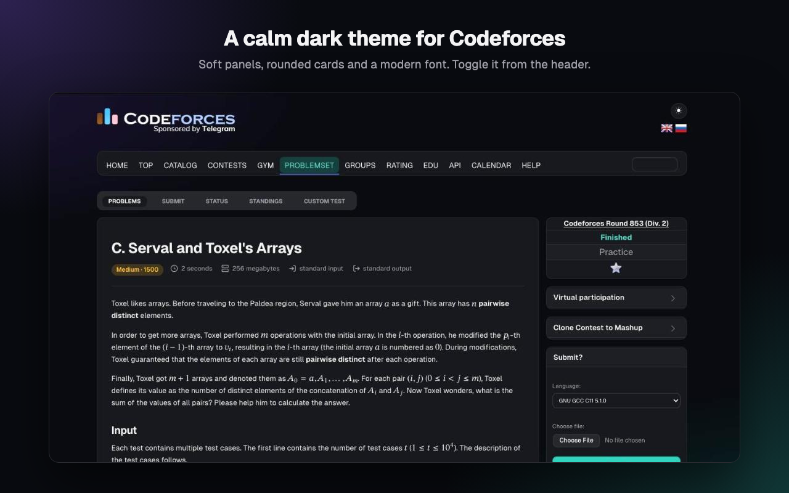
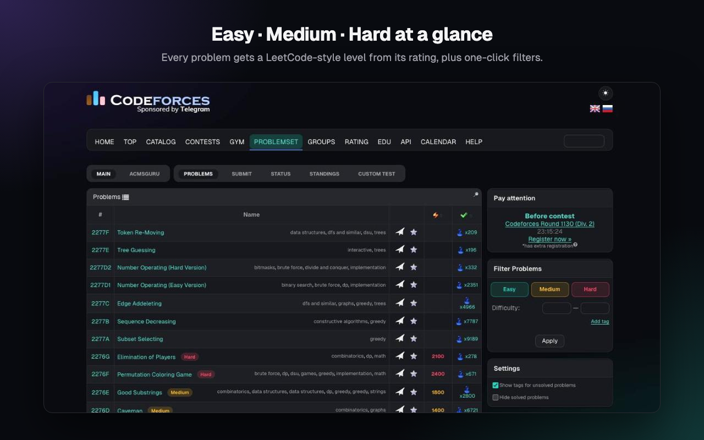
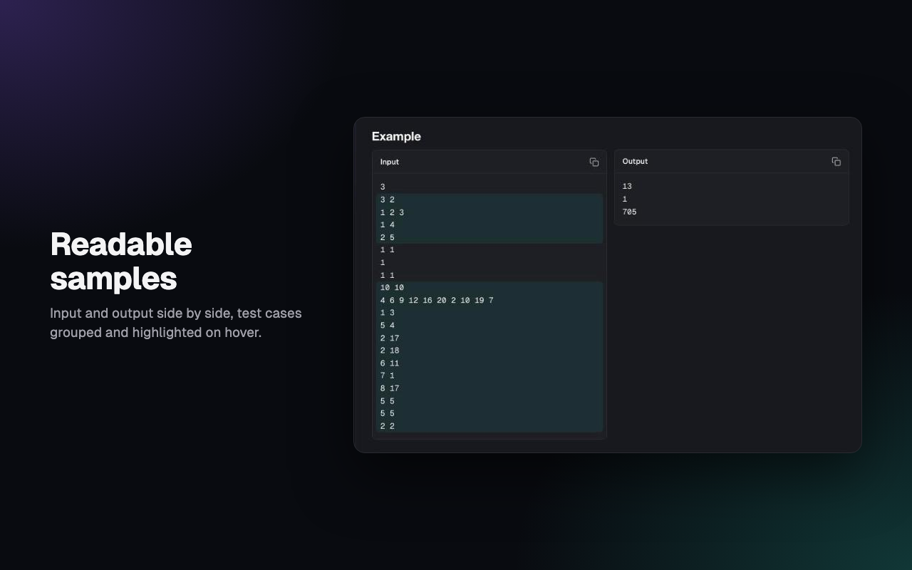
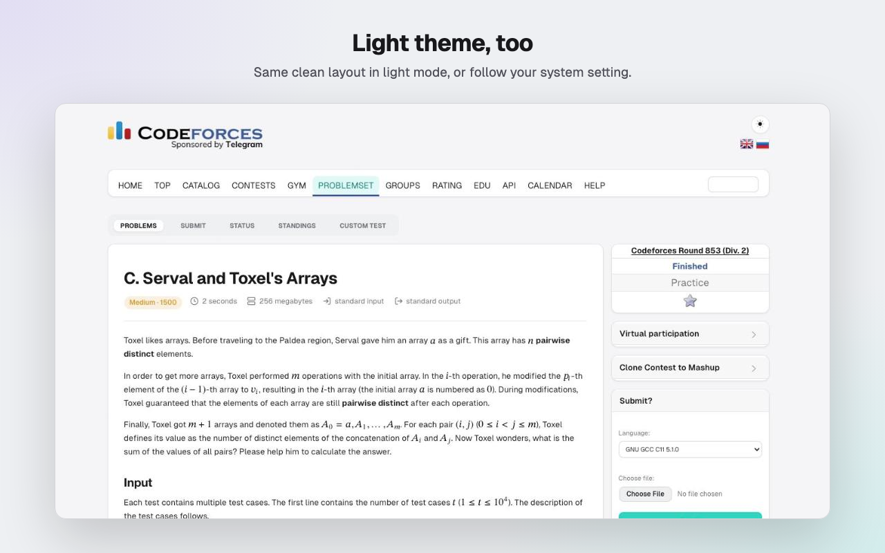
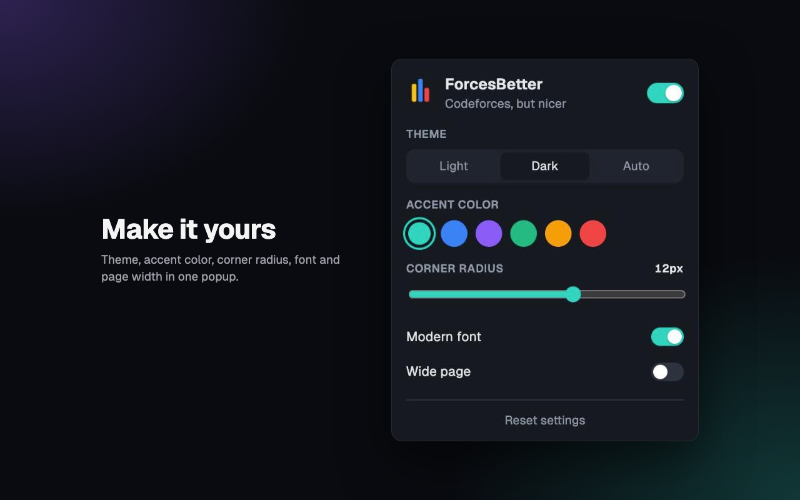

<p align="center">
  
</p>

<h1 align="center">ForcesBetter</h1>

<p align="center">
  Codeforces, but nicer.<br>
  A code editor beside the statement, a dark theme, rounded cards and difficulty tags.
</p>

<p align="center">
  <a href="#install">Install</a> ·
  <a href="#what-it-does">Features</a> ·
  <a href="#updates">Updates</a> ·
  <a href="#privacy">Privacy</a> ·
  <a href="#development">Development</a>
</p>

<p align="center">
  <a href="https://chromewebstore.google.com/detail/fidepiihjojmokebdpdolgheighhmpek"></a>
  <a href="https://github.com/DarkichJs/ForcesBetter/releases"></a>
  
  
  <a href="LICENSE"></a>
</p>

<p align="center">
  
  
</p>

ForcesBetter restyles [Codeforces](https://codeforces.com) and puts a code editor next to every problem. Every page you use while solving gets the same calm look: problems, the archive, submit, status, standings, custom test, blogs, contests and profiles. No tracking and no servers of its own.

## What it does

### Code editor

- **Statement left, editor right.** Like on modern judges. Drag the divider to resize; the statement scrolls on its own while the editor stays put.
- **Run and check samples.** Run your code on your own input, or check it against every sample in one click (Ctrl/⌘+Enter, Ctrl/⌘+Shift+Enter). Codeforces runs it through its Custom Invocation in your session, so verdicts, time and memory are real.
- **Samples tab.** Each sample's input and expected answer, then your output and a Passed / Wrong answer verdict.
- **Submit.** Sends the code to the Codeforces submit form with the problem and language filled in.
- **Editor.** Ace with syntax highlighting and autocompletion for C++, Python, Java, Kotlin, Rust, Go and more, templates, drafts saved per problem, open from file.
- **Focus mode.** Optionally hide the site navigation and the footer for an eolymp-like layout.

### Look and feel

- **Dark theme.** Neutral dark panels with a soft glow, readable formulas and code. Switch it from the ☾ / ☀ button in the site header, or follow your system setting.
- **Light theme.** The same clean layout on a light background.
- **Rounded cards.** Corner images and hard borders are replaced with rounded cards. The radius is adjustable from 0 to 20 px.
- **Modern font.** Geist and Geist Mono instead of the default Verdana and Courier.
- **Accent color.** Teal, blue, violet, green, amber or red for links, buttons and highlights.
- **Wide page.** Optionally let the layout use the full width of large screens.

### Solving problems

- **Difficulty levels.** Every problem gets an **Easy**, **Medium** or **Hard** tag based on its rating: up to 1200, 1300 to 1900, and 2000 and above.
- **One-click filters.** Easy / Medium / Hard buttons in the archive's *Filter Problems* box fill in the rating range for you.
- **Clear limits.** Time and memory limits, input and output files are shown as a compact row with icons.
- **Readable samples.** Input and output sit side by side. Test cases in multi-test input are grouped, and hovering a line highlights its whole test.
- **Tidy submit form.** The sidebar submit box is laid out vertically with a full-width button, and the dark theme covers the code editor.

<p align="center">
  
  
</p>

### Settings

Everything is configured from the toolbar popup and follows you to other devices through Chrome sync.

<p align="center">
  
</p>

## Install

**[Chrome Web Store](https://chromewebstore.google.com/detail/fidepiihjojmokebdpdolgheighhmpek)** (recommended, updates itself).

**From a release.**

1. Download `forcesbetter-<version>.zip` from [Releases](https://github.com/DarkichJs/ForcesBetter/releases) and unzip it.
2. Open `chrome://extensions` and turn on **Developer mode**.
3. Click **Load unpacked** and choose the unzipped folder.

**From source.** Clone the repository and load its folder the same way.

Works in Chrome 111+ and other Chromium browsers (Edge, Brave, Arc, Opera).

## Updates

Installs from the Chrome Web Store update themselves. Chrome checks for a new version every few hours and installs it in the background, so there is nothing to do. Your settings are kept.

Unpacked installs don't update automatically. Download the new release and click **Reload** on the extension card in `chrome://extensions`.

## Privacy

ForcesBetter collects nothing. Your code is only sent to codeforces.com, when you press Run, Samples or Submit. Settings are stored with `chrome.storage.sync` and never leave your browser except through Chrome's own sync. The extension only runs on `codeforces.com` and asks for no permissions beyond storage. See [PRIVACY.md](PRIVACY.md).

## Development

```
src/        content scripts and styles injected into codeforces.com
vendor/     Ace editor (BSD license)
popup/      toolbar popup with the settings
icons/      extension icons
fonts/      Geist and Geist Mono (SIL OFL 1.1)
store/      Chrome Web Store listing text and images
scripts/    packaging
```

Load the folder as an unpacked extension, edit, then click **Reload** in `chrome://extensions` and refresh the Codeforces tab.

### Releasing

1. Build the upload: `scripts/package.sh 1.0.1` bumps the version in `manifest.json` and writes `dist/forcesbetter-1.0.1.zip`.
2. Commit, tag `v1.0.1` and push the tag.
3. The [Release workflow](.github/workflows/release.yml) uploads the zip to the Chrome Web Store, publishes it and attaches it to a GitHub release.

The workflow needs four repository secrets: `CWS_EXTENSION_ID`, `CWS_CLIENT_ID`, `CWS_CLIENT_SECRET` and `CWS_REFRESH_TOKEN`. The [chrome-webstore-upload guide](https://github.com/fregante/chrome-webstore-upload-keys) explains how to get them. Until they are set, upload the zip by hand in the [Developer Dashboard](https://chrome.google.com/webstore/devconsole).

## License

[MIT](LICENSE). Geist fonts by Vercel under the [SIL Open Font License](fonts/OFL.txt). [Ace](https://ace.c9.io) under the [BSD license](vendor/ace/LICENSE). Not affiliated with Codeforces.
